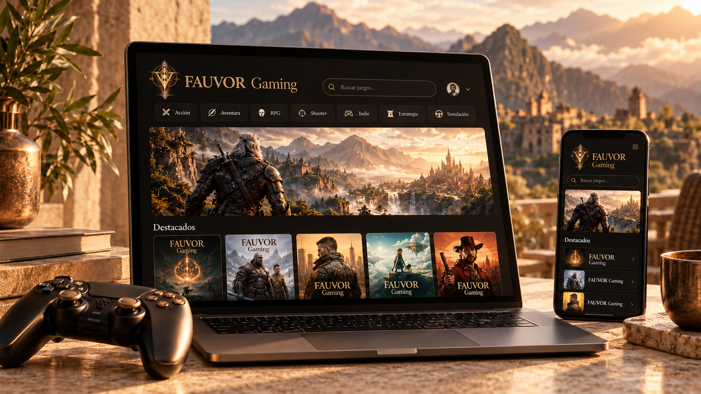

# FAUVOR Gaming

Producto de FAUVOR. Identidad visual: marfil, bronce y dorado; símbolo e iconos del kit original de la marca. Se conserva la URL histórica del repositorio.



> **Ilustración conceptual · No es una captura de una aplicación real.** Las cifras, métricas, pantallas y módulos del mockup son ficticios y no acreditan funcionalidades, resultados ni garantías. Las cantidades de juegos, categorías y jugadores, así como las puntuaciones, son ficticias; no acreditan usuarios, tamaño del catálogo ni valoraciones reales. Las referencias a videojuegos son ilustrativas y no implican afiliación.
>
> **Concept artwork · Not an actual application screenshot.** Figures, metrics, screens and modules are fictional; they do not substantiate implemented features, measured results or security guarantees. Refer to the documentation below for the project’s actual scope.

[Portada para Social Preview · 1280×640](assets/covers/cover-social.jpg) · Ilustración conceptual, no captura real.

[](https://react.dev/)
[](https://vitejs.dev/)
[](https://getbootstrap.com/)
[](https://reactrouter.com/)
[](#)

Demo educativa de catálogo web **FRANCIS GAMER**, desarrollada con **React 19**, **Vite**, **Bootstrap 5** y **React Router**. Cuenta con carrusel cinematográfico con selector lateral, catálogo de 19 videojuegos con referencias a Steam con assets locales sincronizados, fichas de producto con especificaciones técnicas, sistema de reseñas y panel de administración con control de acceso en el cliente.

> 🚀 **Demo educativa (Vercel):** [https://byte-brothers-rolling-gamer.vercel.app/](https://byte-brothers-rolling-gamer.vercel.app/)

---

## 📌 Tabla de Contenidos
1. [Descripción del Proyecto](#-descripción-del-proyecto)
2. [Requerimientos Cumplidos](#-requerimientos-cumplidos)
3. [Credenciales de Acceso para Evaluación](#-credenciales-de-acceso-para-evaluación)
4. [Instalación y Ejecución Local](#-instalación-y-ejecución-local)
5. [Estructura del Proyecto](#-estructura-del-proyecto)
6. [Equipo de Desarrollo](#-equipo-de-desarrollo)
7. [Demo publicada (Vercel)](#-demo-publicada-vercel)

---

## 📖 Descripción del Proyecto

FRANCIS GAMER es un proyecto educativo de catálogo que ofrece:
- **Catálogo digital de 19 videojuegos** precargados con datos de referencia, precios ilustrativos, géneros, capturas locales y requisitos de sistema.
- **Buscador en tiempo real** por título, desarrollador y género.
- **Filtros por categoría** (Acción, Disparos, Carreras, Estrategia, Simulación) y opciones de ordenamiento por precio y satisfacción.
- **Ficha técnica extendida** (`/detalle/:id`) con requisitos mínimos y recomendados de hardware (SO, Procesador, RAM, Tarjeta Gráfica y Espacio en Disco).
- **Sistema interactivo de reseñas** con cálculo dinámico en tiempo real del porcentaje de satisfacción estilo Steam (*Extremadamente Positivas*, *Mayormente Positivas*, *Mixtas*).
- **Lista de deseos personal (Wishlist)** guardada por cuenta demo en este navegador.
- **Panel de Control de Administración (`/admin`)** con guardián de rutas en el cliente y CRUD para crear, editar y eliminar videojuegos, además de una tabla de gestión de usuarios registrados.

---

## ✅ Requerimientos Cumplidos

| Requisito | Detalle Técnico | Estado |
| :--- | :--- | :---: |
| **Persistencia y Estado** | Catálogo de juegos, usuarios registrados, sesión activa y lista de deseos sincronizados con `LocalStorage` y `useEffect`. | ✅ |
| **Enrutamiento (React Router)** | `/` (Inicio), `/detalle/:id` (Ficha técnica), `/admin` (Panel CRUD), `/about` (Equipo), `/wishlist` (Deseos), `/login` (Acceso), `/404` (Error personalizado). | ✅ |
| **Catálogo con Filtros** | Búsqueda por nombre en vivo, filtro por categorías y selector de ordenamiento múltiple. | ✅ |
| **Detalle del Videojuego** | Nombre, precio, categoría, imagen principal, galería de capturas, descripción breve y completa, requisitos de sistema y desarrollador. | ✅ |
| **Sistema de Reseñas** | Cálculo dinámico de % de votos positivos y negativos. Los usuarios autenticados pueden votar (👍 / 👎) y redactar su opinión. | ✅ |
| **Lista de Deseos (Wishlist)** | Guardado/eliminación reactiva de juegos favoritos exclusivo para usuarios con sesión activa. | ✅ |
| **Panel CRUD de Videojuegos** | Tabla interactiva para listar, agregar (`/crear`), modificar (`/editar/:id`) y eliminar con confirmación de `SweetAlert2`. | ✅ |
| **Gestión de Usuarios** | Tabla de usuarios registrados para visualización y eliminación (con protección de la cuenta admin activa). | ✅ |
| **Control de rutas en el cliente** | Componente guardián `RutaProtegida` que restringe el acceso al panel `/admin` solo a usuarios con rol `admin`. | ✅ |
| **Simulación de Autenticación** | Login y Registro con validaciones, hashing/distinción entre Administrador precargado y usuarios invitados. | ✅ |
| **Catálogo de 19 Juegos Steam** | **19 videojuegos de referencia** precargados con assets locales sincronizados, trailers y especificaciones técnicas. | ✅ |
| **Diseño Responsive & Moderno** | UI moderna para gaming con paleta oscura, acentos neon, cards interactivas y tipografía Google Fonts. | ✅ |

---

## 🔑 Credenciales de Acceso para Evaluación

**Cuentas demo públicas y ficticias.** La autenticación, los roles, las reseñas y la lista de deseos se simulan en el navegador con `LocalStorage`. El hashing de claves y el guardián de rutas no sustituyen autenticación ni autorización del servidor. No usar contraseñas personales ni información sensible. No se implementa un servicio comercial de pagos ni se afirma afiliación con Steam.

**Educational demo:** authentication and roles run in the browser; they are not production security guarantees. Catalog prices and local reviews do not represent live store prices or community ratings.

Para la evaluación del proyecto, pueden utilizarse las siguientes cuentas predeterminadas en la pantalla de [Iniciar Sesión](https://byte-brothers-rolling-gamer.vercel.app/login), o bien registrar nuevas cuentas desde el formulario:

### 👑 Perfil Administrador (Acceso completo a `/admin`)
- **Titular:** Francisco Delgado (Team Leader)
- **Correo Electrónico:** `admin@rollinggames.com`
- **Contraseña:** `Admin123!`
- **Permisos:** Gestión de inventario (CRUD videojuegos), recarga de datos de fábrica y eliminación de usuarios.

### 👤 Perfil Usuario Gamer (Cliente estándar)
- **Titular:** Franco Triviño (Scrum Master)
- **Correo Electrónico:** `user@rollinggames.com`
- **Contraseña:** `User123!`
- **Permisos:** Navegación, guardado en lista de deseos y publicación de reseñas comunitarias.

> *Nota: También es posible registrar nuevos usuarios desde la pestaña "Crear Cuenta".*

---

## 🚀 Instalación y Ejecución Local

1. **Clonar el repositorio:**
   ```bash
   git clone https://github.com/Franc-Devel/Francis-Gamer.git
   cd Francis-Gamer
   ```

2. **Instalar dependencias:**
   ```bash
   npm install
   ```

3. **Iniciar el servidor de desarrollo:**
   ```bash
   npm run dev
   ```

4. **Abrir en el navegador:**
   Ingresa a `http://localhost:5173` (o el puerto indicado en la consola).

5. **Compilar para producción (Build):**
   ```bash
   npm run build
   ```

---

## 📁 Estructura del Proyecto

```text
Francis-Gamer/
├── vercel.json                 # Configuración de enrutamiento SPA para Vercel
├── public/
│   └── _redirects              # Redirección complementaria de rutas SPA
├── src/
│   ├── components/
│   │   ├── common/
│   │   │   ├── Menu.jsx        # Navbar con avatar, roles y contador de deseos
│   │   │   ├── Footer.jsx      # Pie de página gamer con enlaces y créditos
│   │   │   └── RutaProtegida.jsx # Control de navegación en el cliente
│   │   └── pages/
│   │       ├── Inicio.jsx      # Catálogo con Hero, buscador y filtros
│   │       ├── DetalleDeProducto.jsx # Ficha técnica, requisitos y reseñas dinámicas
│   │       ├── Administrador.jsx # Panel de control (CRUD Juegos y Usuarios)
│   │       ├── Login.jsx       # Login & Registro con acceso demo rápido
│   │       ├── Wishlist.jsx    # Lista de deseos del usuario
│   │       ├── About.jsx       # Información del equipo, Trello y metodologías
│   │       ├── Error404.jsx    # Pantalla 404 personalizada con temática gamer
│   │       └── producto/
│   │           ├── CardJuego.jsx          # Tarjeta interactiva de juego
│   │           ├── FormularioProducto.jsx # Creación y edición con react-hook-form
│   │           └── ItemProducto.jsx       # Fila de tabla de administración
│   ├── context/
│   │   └── AuthContext.jsx     # Contexto global de sesión, usuarios y wishlist
│   ├── data/
│   │   ├── juegosIniciales.js  # Dataset de 19 videojuegos reales con especificaciones y assets locales
│   │   └── usuariosIniciales.js # Cuentas predeterminadas (Admin y Usuario)
│   ├── App.jsx                 # Configuración de rutas y estado de inventario
│   ├── index.css               # Sistema de diseño gamer con CSS variables
│   └── main.jsx                # Inicialización de la aplicación
├── package.json
└── vite.config.js
```

---

## 👥 Equipo de Desarrollo y Metodología

El proyecto fue concebido, diseñado e implementado por:
- **[Francisco Delgado (Franc-Devel)](https://github.com/Franc-Devel)**: *Team Leader & Full Stack Developer* — Arquitectura general con React 19, persistencia de catálogo en `LocalStorage`, enrutamiento con React Router, control de rutas en el cliente y panel de administración.
- **[Franco Triviño (francotrivio321)](https://github.com/francotrivio321)**: *Scrum Master & Frontend Developer* — Organización ágil y gestión de sprints en Trello, diseño temático inspirado en Epic Games Store, validaciones de formularios y experiencia de usuario.

### 📋 Gestión del Proyecto y Código Fuente
- **Tablero Ágil Oficial (Trello):** [https://trello.com/b/qyopevQH/rolling-gamer](https://trello.com/b/qyopevQH/rolling-gamer)
- **Repositorio Oficial (GitHub):** [https://github.com/Franc-Devel/Francis-Gamer](https://github.com/Franc-Devel/Francis-Gamer)

---

## 🌐 Demo publicada (Vercel)

El proyecto se encuentra desplegado y accesible públicamente en **Vercel**:
- 🔗 **Demo Oficial en Vivo:** [https://byte-brothers-rolling-gamer.vercel.app/](https://byte-brothers-rolling-gamer.vercel.app/)

El repositorio incluye el archivo de configuración `vercel.json` con reglas de reescritura hacia `/index.html`, para que el enrutamiento del lado del cliente (`client-side routing` de React Router) funcione correctamente al recargar páginas profundas como `/detalle/:id`, `/admin` o `/wishlist`.

---

© 2025 **FRANCIS GAMER** - Proyecto Educativo para RollingCode School.
